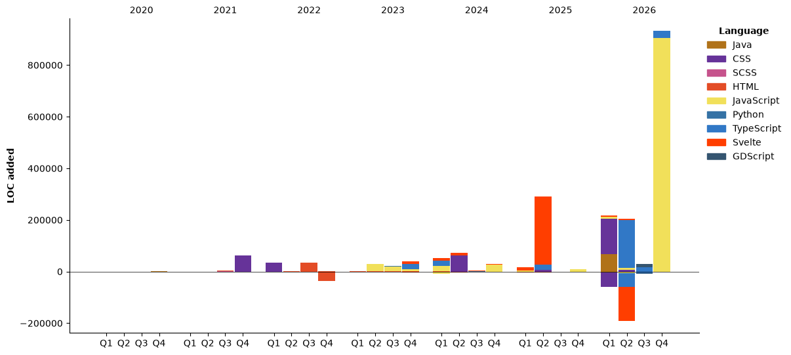

<samp href="https://anshwadhwa.vercel.app">
    <h3>Hey, i'm Ansh Wadhwa</h3>
    <p>Student, Developer, and Designer — I love making cool things! ^_^</p>
    <br />
    I'm 18 and I enjoy experimenting with different programming languages. (psst... I used to use arch btw now macos :/ )
    <br />
    <br />
    <code>Typescript</code> <code>Python</code> <code>Discord.py</code> <code>Svelte</code> <code>JS</code> <code>React</code> <code>React-Native</code> <code>C++</code>
    <br />
    <br />
    <h2></h2>
    🌎 <a href="https://anshwadhwa.vercel.app" target="_blank">My Site</a>
    <br/>
    ✉️ <a href="mailto:work.awadhwa@gmail.com" target="_blank">Mail Me</a>
    <br/>
    ☕️ <a href="https://buymeacoffee.com/anshwadhwa8" target="_blank">Buy Me A Coffee</a>
    <br/>
    👤 <a href="https://discord.com/users/600278222428438559" target="_blank">@punchoneman</a>
</samp>


<br />
<br />
<hr />
<details>
<summary> Click To See My Stats </summary>
<br />
<br />

<!--START_SECTION:waka-->


**🐱 My GitHub Data** 

> 📦 482.2 kB Used in GitHub's Storage 
 > 
> 🏆 208 Contributions in the Year 2026
 > 
> 🚫 Not Opted to Hire
 > 
> 📜 51 Public Repositories 
 > 
> 🔑 11 Private Repositories 
 > 
**I'm a Night 🦉** 

```text
🌞 Morning                185 commits         ████░░░░░░░░░░░░░░░░░░░░░   14.10 % 
🌆 Daytime                460 commits         █████████░░░░░░░░░░░░░░░░   35.06 % 
🌃 Evening                539 commits         ██████████░░░░░░░░░░░░░░░   41.08 % 
🌙 Night                  128 commits         ██░░░░░░░░░░░░░░░░░░░░░░░   09.76 % 
```
📅 **I'm Most Productive on Friday** 

```text
Monday                   173 commits         ███░░░░░░░░░░░░░░░░░░░░░░   13.19 % 
Tuesday                  150 commits         ███░░░░░░░░░░░░░░░░░░░░░░   11.43 % 
Wednesday                218 commits         ████░░░░░░░░░░░░░░░░░░░░░   16.62 % 
Thursday                 179 commits         ███░░░░░░░░░░░░░░░░░░░░░░   13.64 % 
Friday                   228 commits         ████░░░░░░░░░░░░░░░░░░░░░   17.38 % 
Saturday                 207 commits         ████░░░░░░░░░░░░░░░░░░░░░   15.78 % 
Sunday                   157 commits         ███░░░░░░░░░░░░░░░░░░░░░░   11.97 % 
```


📊 **This Week I Spent My Time On** 

```text
🕑︎ Time Zone: Asia/Kolkata

💬 Programming Languages: 
TypeScript               1 hr 44 mins        █████████████████████░░░░   82.16 % 
Markdown                 11 mins             ██░░░░░░░░░░░░░░░░░░░░░░░   09.32 % 
JSON                     7 mins              █░░░░░░░░░░░░░░░░░░░░░░░░   05.67 % 
JavaScript               3 mins              █░░░░░░░░░░░░░░░░░░░░░░░░   02.84 % 

🔥 Editors: 
Zed                      2 hrs 6 mins        █████████████████████████   99.52 % 
Antigravity              0 secs              ░░░░░░░░░░░░░░░░░░░░░░░░░   00.48 % 

🐱‍💻 Projects: 
miragefrontend           1 hr 47 mins        █████████████████████░░░░   84.43 % 
DetroGo_Muticity         8 mins              ██░░░░░░░░░░░░░░░░░░░░░░░   06.66 % 
cities                   7 mins              ██░░░░░░░░░░░░░░░░░░░░░░░   06.17 % 
Unknown Project          3 mins              █░░░░░░░░░░░░░░░░░░░░░░░░   02.66 % 
DetroGo                  0 secs              ░░░░░░░░░░░░░░░░░░░░░░░░░   00.08 % 

💻 Operating System: 
Mac                      2 hrs 6 mins        █████████████████████████   100.00 % 
```

🤖 **AI Coding This Week** 

```text
⏱ AI Coding Time: 13 mins (10.63%)

✍️ 0 lines written by AI, 600 lines written by hand (0.0% AI-written)

🔤 373,887 Input Tokens, 62,063 Output Tokens

💵 $1.69 Estimated AI Cost This Week

🧠 3 AI Sessions, 1 AI Prompts

Gemini                   0 lines             ░░░░░░░░░░░░░░░░░░░░░░░░░   00.00 % 
Opus                     0 lines             ░░░░░░░░░░░░░░░░░░░░░░░░░   00.00 % 

🔎 AI Coding Insights:
🧑‍💻 Mostly Hands-On — 0.0% of written lines came from AI
📄 Detailed Prompter — average 1,268 characters per prompt
🎯 One-Shot Prompter — average 0 prompts per session
🔍 Hands-On Reviewer — 100.0% of changed lines were hand-edited
```

**I Mostly Code in Python** 

```text
Python                   12 repos            █████░░░░░░░░░░░░░░░░░░░░   21.43 % 
JavaScript               10 repos            ████░░░░░░░░░░░░░░░░░░░░░   17.86 % 
TypeScript               8 repos             ████░░░░░░░░░░░░░░░░░░░░░   14.29 % 
Svelte                   7 repos             ███░░░░░░░░░░░░░░░░░░░░░░   12.50 % 
Java                     2 repos             █░░░░░░░░░░░░░░░░░░░░░░░░   03.57 % 
```


**Timeline**




 Last Updated on 10/11/2026 06:49:58 UTC
<!--END_SECTION:waka-->
</details>
