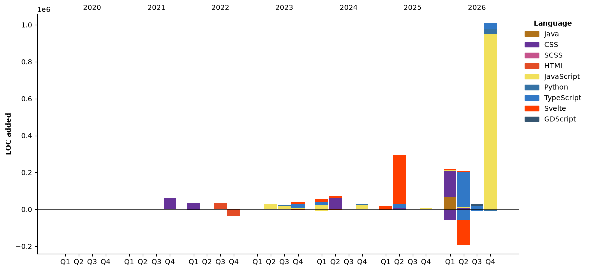

<samp href="https://anshwadhwa.vercel.app">
    <h3>Hey, i'm Ansh Wadhwa</h3>
    <p>Student, Developer, and Designer — I love making cool things! ^_^</p>
    <br />
    I'm 18 and I enjoy experimenting with different programming languages. (psst... I used to use arch btw now macos :/ )
    <br />
    <br />
    <code>Typescript</code> <code>Python</code> <code>Discord.py</code> <code>Svelte</code> <code>JS</code> <code>React</code> <code>React-Native</code> <code>C++</code>
    <br />
    <br />
    <h2></h2>
    🌎 <a href="https://anshwadhwa.vercel.app" target="_blank">My Site</a>
    <br/>
    ✉️ <a href="mailto:work.awadhwa@gmail.com" target="_blank">Mail Me</a>
    <br/>
    ☕️ <a href="https://buymeacoffee.com/anshwadhwa8" target="_blank">Buy Me A Coffee</a>
    <br/>
    👤 <a href="https://discord.com/users/600278222428438559" target="_blank">@punchoneman</a>
</samp>


<br />
<br />
<hr />
<details>
<summary> Click To See My Stats </summary>
<br />
<br />

<!--START_SECTION:waka-->


**🐱 My GitHub Data** 

> 📦 482.2 kB Used in GitHub's Storage 
 > 
> 🏆 210 Contributions in the Year 2026
 > 
> 🚫 Not Opted to Hire
 > 
> 📜 51 Public Repositories 
 > 
> 🔑 11 Private Repositories 
 > 
**I'm a Night 🦉** 

```text
🌞 Morning                188 commits         ████░░░░░░░░░░░░░░░░░░░░░   14.23 % 
🌆 Daytime                463 commits         █████████░░░░░░░░░░░░░░░░   35.05 % 
🌃 Evening                540 commits         ██████████░░░░░░░░░░░░░░░   40.88 % 
🌙 Night                  130 commits         ██░░░░░░░░░░░░░░░░░░░░░░░   09.84 % 
```
📅 **I'm Most Productive on Friday** 

```text
Monday                   173 commits         ███░░░░░░░░░░░░░░░░░░░░░░   13.10 % 
Tuesday                  150 commits         ███░░░░░░░░░░░░░░░░░░░░░░   11.36 % 
Wednesday                218 commits         ████░░░░░░░░░░░░░░░░░░░░░   16.50 % 
Thursday                 179 commits         ███░░░░░░░░░░░░░░░░░░░░░░   13.55 % 
Friday                   228 commits         ████░░░░░░░░░░░░░░░░░░░░░   17.26 % 
Saturday                 211 commits         ████░░░░░░░░░░░░░░░░░░░░░   15.97 % 
Sunday                   162 commits         ███░░░░░░░░░░░░░░░░░░░░░░   12.26 % 
```


📊 **This Week I Spent My Time On** 

```text
🕑︎ Time Zone: Asia/Kolkata

💬 Programming Languages: 
TypeScript               1 hr 52 mins        █████████░░░░░░░░░░░░░░░░   34.86 % 
Python                   1 hr 42 mins        ████████░░░░░░░░░░░░░░░░░   31.73 % 
JavaScript               38 mins             ███░░░░░░░░░░░░░░░░░░░░░░   11.93 % 
JSON                     34 mins             ███░░░░░░░░░░░░░░░░░░░░░░   10.82 % 
Markdown                 18 mins             █░░░░░░░░░░░░░░░░░░░░░░░░   05.78 % 

🔥 Editors: 
Zed                      5 hrs 23 mins       █████████████████████████   100.00 % 

🐱‍💻 Projects: 
mirage-backend           1 hr 41 mins        ████████░░░░░░░░░░░░░░░░░   31.36 % 
mirage-frontend          1 hr 31 mins        ███████░░░░░░░░░░░░░░░░░░   28.21 % 
Unknown Project          1 hr 3 mins         █████░░░░░░░░░░░░░░░░░░░░   19.67 % 
miragefrontend           31 mins             ██░░░░░░░░░░░░░░░░░░░░░░░   09.88 % 
files-mentioned-by-the-us22 mins             ██░░░░░░░░░░░░░░░░░░░░░░░   06.90 % 

💻 Operating System: 
Mac                      5 hrs 23 mins       █████████████████████████   100.00 % 
```

🤖 **AI Coding This Week** 

```text
⏱ AI Coding Time: 3 hrs 1 min (56.19%)

✍️ 4,261 lines written by AI, 389 lines written by hand (91.63% AI-written)

🔤 1,971,513 Input Tokens, 357,054 Output Tokens

💵 $37.88 Estimated AI Cost This Week

🧠 10 AI Sessions, 15 AI Prompts

GPT                      4,306 lines         █████████████████████████   100.00 % 
Opus                     0 lines             ░░░░░░░░░░░░░░░░░░░░░░░░░   00.00 % 

🔎 AI Coding Insights:
🤖 AI-Driven — 91.63% of written lines came from AI
📄 Detailed Prompter — average 963 characters per prompt
🔁 Iterative Prompter — average 2 prompts per session
🚀 High AI Trust — 14.51% of changed lines were hand-edited
```

**I Mostly Code in Python** 

```text
Python                   12 repos            █████░░░░░░░░░░░░░░░░░░░░   21.05 % 
JavaScript               11 repos            █████░░░░░░░░░░░░░░░░░░░░   19.30 % 
TypeScript               8 repos             ████░░░░░░░░░░░░░░░░░░░░░   14.04 % 
Svelte                   7 repos             ███░░░░░░░░░░░░░░░░░░░░░░   12.28 % 
Java                     2 repos             █░░░░░░░░░░░░░░░░░░░░░░░░   03.51 % 
```


**Timeline**




 Last Updated on 15/11/2026 23:04:53 UTC
<!--END_SECTION:waka-->
</details>
